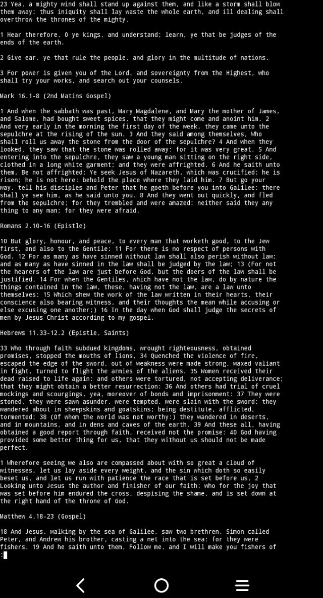

# Deacon

Utility that fetches daily Orthodox readings and fasting information, supporting
both Julian and Gregorian calendars, for interactive or automated use. This
script essentially parses RSS feeds provided by https://orthocal.info.

*Why did you make this?*

I noticed there was no good (according to me) daily information software for
*Julian Calendar* Orthodox Christians. It needs to be:

- minimal
- cli only (the most efficient computer interface)
- easy to use on android via termux or termux shortcuts
- have an offline cache
- support automatic and pager usage
- support both julian and gregorian calendars
- be public-domain and free
- be  self contained in one file
- posix compliant, work everywhere

I have found no other alternative. 

Deacon however is not meant to be a general purpose commandline bible, there are
tools like [diatheke](https://wiki.crosswire.org/Frontends:Diatheke), which do
that job great enough.

## Showcase

<a href="https://asciinema.org/a/g8gkNIB79kWky41r" target="_blank"></a>



## Try it!

```
sh <( curl -fsSL https://codeberg.org/knyz/deacon/raw/branch/master/deacon)
```

## Download to ~/.local/bin/
*Ensure $HOME/.local/bin/ is actually in your $PATH*
```
cd ~/.local/bin/ && curl -OfsSL "https://codeberg.org/knyz/deacon/raw/branch/master/deacon" && chmod +x deacon
```
## Usage
```
  -j - use julian/old calendar (default)
  -g - use gregorian/new calendar
  -i - interactive, uses PAGER to read text
  -s - status bar mode, outputs minimal information
  -h - display this information"
  -p - Use a prayer rule, which are plaintext files in ~/.local/share/vlmtools/prayers/
```
## Examples
```
# Read the Julian calendar readings and fasting information interactively
deacon -ji

# Read the Gregorian calendar readings, outputting to stdout
deacon -g

# Pray a prayer rule called 'seraphim', and read the Julian calendar readings
# interactively

deacon -ji -p seraphim
```
## Dependencies

- xmlstarlet
- curl
- w3m

## INFO
Website: https://vilyaem.xyz

Support this project:

XMR:48Sxa8J6518gqp4WeGtQ4rLe6SctPrEnnCqm6v6ydjLwRPi9Uh9gvVuUsU2AEDw75meTHCNY8KfU6Txysom4Bn5qPKMJ75w
        
WOW:WW2L2yC6DMg7GArAH3nqXPA6UBoRogf64GodceqA32SeZQpx27xd6rqN82e36KE48a8SAMSoXDB5WawAgVEFKfkw1Q5KSGfX9
    
Liberapay: https://liberapay.com/vilyaem/donate

## "LICENSE"

Public Domain CC0.
